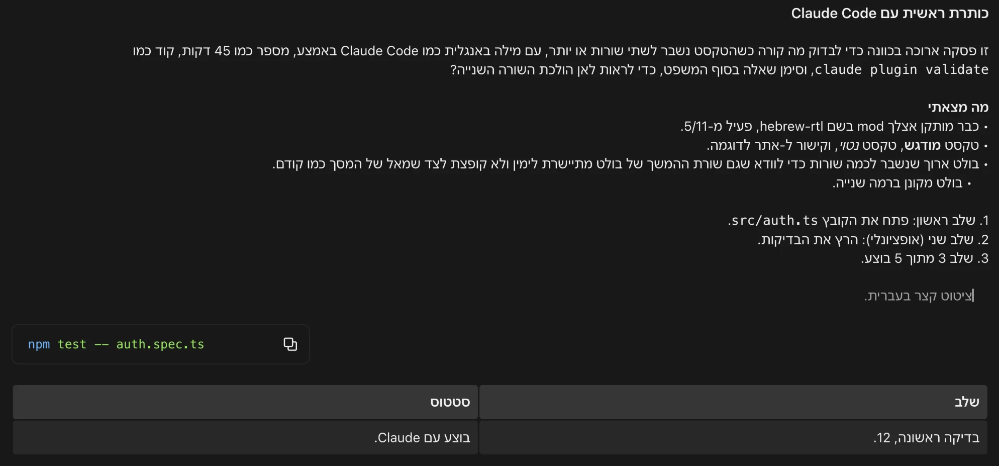

# claude-hebrew-rtl

Hebrew right to left in Claude Code, on the computer and on the phone.




## התקנה מהירה

1. פתחו את אפליקציית Claude ב-Mac, עברו ללשונית Code, ופתחו שיחה חדשה.
2. הדביקו את השורה הבאה ושלחו:

```text
התקן לי את התוסף מהקישור הזה, בדיוק לפי הקובץ INSTALL.md שנמצא בו: https://github.com/omerm-AI/claude-hebrew-rtl
```

3. אשרו את הפעולות ש-Claude מבקש. הוא מסביר בעברית מה כל אחת עושה.
4. כש-Claude כותב שההתקנה הצליחה, פתחו שיחה חדשה וכתבו משפט בעברית.

השיחה שבה התקנתם לא משתנה. השינוי מופיע בשיחה חדשה.

## If you are Claude

A user gave you this repository and asked you to install it. Open [INSTALL.md](INSTALL.md) and
follow it exactly, step by step. Do not improvise and do not rewrite any file.

## What it does

| Where you read the conversation | What changes |
| --- | --- |
| Claude desktop app on a Mac, Code tab | Replies are drawn right to left: paragraphs, headings, bullets, numbered and nested lists, quotes, wrapped lines included. Tables read right to left. Code stays left to right. Your own prompts and question dialogs read in the right order. |
| Claude phone app, for sessions that run on that Mac | New replies are saved so that bullets, numbers, short lines and headings sit on the right. Seen on Android; not checked on iPhone. |
| Browser and Cowork | Nothing to install: Hebrew is already laid out right to left there. |

Not covered: Windows, sessions that run in the cloud rather than on your Mac, and the app's own
chrome (sidebar, menus, the message box).

## What to know before installing

- The install copies files into one folder, `~/.claude/maind-mods`, and registers the mod with
  Claude Code. It downloads nothing else and asks for no password.
- Everything runs on your computer. Nothing is sent anywhere.
- The desktop drawing costs no tokens. The phone fix adds a few invisible characters to each
  saved Hebrew reply, which the model reads again on later turns: a small addition, not
  measured exactly.
- Because of the phone fix, text copied from a reply may carry spaces at the end of a line.
- On the phone, only replies written after the install change.

## How it works

Two screens show the same conversation, and each needs its own fix. The desktop app draws what
a mod hands it, so every reply is laid out word by word, right to left. The phone app takes no
drawing from a mod, so the reply's lists are rewritten as right-to-left lines just before the
reply is saved. The full story, in Hebrew: [docs/how-it-works-he.md](docs/how-it-works-he.md).
The technical notes: [mods/hebrew-rtl/README.md](mods/hebrew-rtl/README.md).

## Other ways to install

With the Claude Code CLI and git:

```bash
claude plugin install hebrew-rtl --marketplace omerm-AI/claude-hebrew-rtl
```

In the desktop app: click + next to the prompt box, then Plugins, Add marketplace with
`omerm-AI/claude-hebrew-rtl`, then Add plugin.

## Remove

Ask Claude Code:

```text
Uninstall the Claude Code plugin "hebrew-rtl@maind-mods" from the user scope, then remove the plugin marketplace "maind-mods". Tell me in Hebrew when it is done.
```

## Checks

```bash
claude plugin validate mods/hebrew-rtl
claude plugin test mods/hebrew-rtl
```

Version 0.3.2. Tested on macOS with Claude Code 2.1.325 and on Android through Remote Control.
